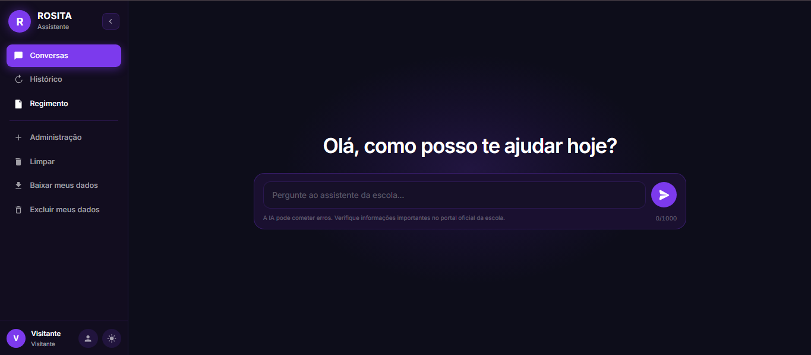
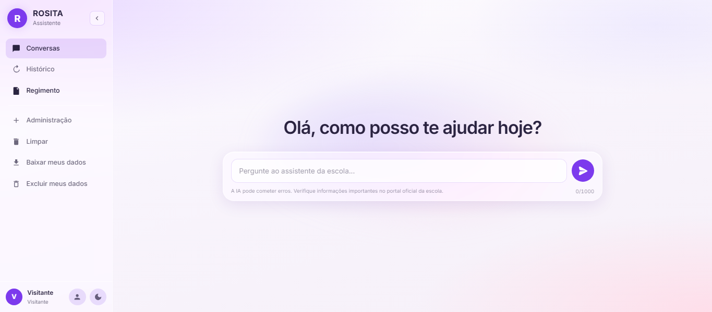
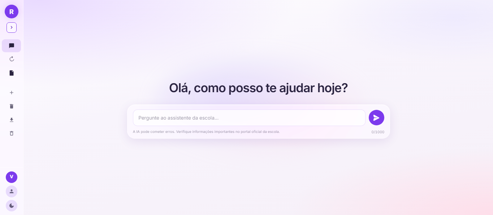
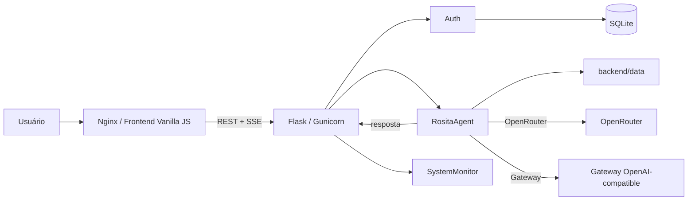

# ROSITA — Assistente Virtual Escolar com IA

[](https://www.python.org/)
[](https://flask.palletsprojects.com/)
[](https://developer.mozilla.org/docs/Web/JavaScript)
[](https://sqlite.org/)
[](https://www.docker.com/)
[](https://pytest.org/)

A ROSITA é uma assistente virtual escolar desenvolvida para a PEI Rosa Bonfiglioli.
Ela permite consultas ao Regimento Escolar ECIM por meio de uma interface web responsiva, com respostas geradas por provedores de IA configuráveis e conteúdo institucional definido pela escola.

## Demonstração Visual

| Tema escuro — visão principal | Tema claro — visão principal | Tema claro — sidebar compacta |
|---|---|---|
|  |  |  |

## Sobre o Projeto

A consulta a documentos escolares extensos pode ser lenta e pouco acessível para alunos, familiares e profissionais da instituição. A ROSITA organiza esse conhecimento em uma interface de conversa, consulta o Regimento Escolar ECIM como contexto e oferece respostas com streaming em tempo real.

Como proposta de valor, o projeto reúne acessibilidade, consulta institucional, administração operacional e controles de privacidade em uma única aplicação acadêmica pronta para implantação local ou em contêineres.

## Principais Funcionalidades

### Atendimento e Experiência de Uso

- Chat com respostas em streaming via Server-Sent Events (SSE).
- Validação do tamanho e do conteúdo das mensagens.
- Visualização do PDF oficial do Regimento Escolar ECIM na interface.
- Acesso anônimo ao chat, sem necessidade de cadastro.
- Histórico da sessão e temas claro/escuro.

### Inteligência Artificial e Administração

- Provedores OpenRouter e Gateway local OpenAI-compatible, selecionáveis em runtime.
- Seleção de modelo disponível para o provedor ativo.
- Edição dos arquivos de referência `.txt` pela área administrativa, com backup `.bak`.
- Painel de Status do Sistema e endpoint `/api/health`.

### Segurança e Privacidade (LGPD)

- Senhas administrativas em hash `scrypt`, com comparação segura e mitigação de timing attack.
- Autenticação de sessão com limite de taxa em login e chat, além do limite global.
- Aviso de privacidade versionado e consentimento explícito.
- Retenção configurável e escolha de persistência do histórico.
- Exportação dos dados da sessão em JSON e exclusão do histórico e do consentimento.

## Arquitetura



### Stack Tecnológica

| Camada | Tecnologia | Finalidade |
|---|---|---|
| Interface | HTML5, CSS3 e JavaScript Vanilla | Aplicação web responsiva sem bundler |
| Servidor web | Nginx | Arquivos estáticos e proxy de `/api` |
| Backend | Python, Flask e Gunicorn | API REST, SSE e regra de aplicação |
| Persistência | SQLite | Histórico por sessão/usuário e consentimentos |
| Inteligência artificial | OpenRouter ou Gateway OpenAI-compatible | Geração de respostas e seleção de modelos |
| Contêineres | Docker Compose | Integração entre web e backend |
| Qualidade | Pytest | Testes automatizados do backend e da integração web |

## Estrutura do Repositório

```text
ROSITA/
├── README.md
├── backend/
│   ├── app.py
│   ├── data/
│   ├── src/rosita/
│   ├── Dockerfile
│   └── requirements.txt
├── web/
│   ├── index.html
│   ├── styles/
│   ├── scripts/
│   ├── nginx.conf
│   └── Dockerfile
├── docs/
│   ├── README.md
│   ├── arquitetura-backend.md
│   ├── arquitetura-frontend.md
│   └── PLANO_MELHORIAS.md
├── tests/
├── docker-compose.yml
├── start_system.bat
└── start_system.sh
```

## Como Executar

### Opção 1 — Docker Compose (Recomendado / Produção)

1. Copie `.env.example` para `.env` e configure o provedor de IA e as credenciais.
2. Em produção, coloque a aplicação atrás de um proxy reverso com HTTPS e encaminhe `X-Forwarded-Proto: https`.
3. Inicie os serviços:

```bash
docker compose up -d --build
```

A interface é publicada em `http://127.0.0.1:18080` quando `ROSITA_WEB_PORT=18080`.
Sem essa variável no Compose, o fallback publicado é `18888`.

> Não exponha o Compose diretamente em HTTP na internet. Para testes locais,
> configure explicitamente `ROSITA_REQUIRE_HTTPS=false` e
> `ROSITA_SESSION_COOKIE_SECURE=false`.

### Opção 2 — Execução Local Automatizada

**Windows**

```bat
start_system.bat
```

**Linux / MiniOS**

```bash
chmod +x start_system.sh
./start_system.sh
```

Os scripts criam ou reutilizam o ambiente virtual, instalam as dependências e
sobem o backend em `127.0.0.1:18500` e o frontend em `127.0.0.1:18080`.

### Execução Manual

<details>
<summary>Comandos manuais para backend, frontend e CLI</summary>

**Backend**

```bash
cd backend
pip install -r requirements.txt
python app.py
```

**Frontend com proxy para o backend**

```bash
cd web
python scripts/dev_server.py
```

O frontend fica disponível em `http://127.0.0.1:18080` por padrão. O servidor
de desenvolvimento encaminha `/api/*` para o backend local.

**CLI opcional**

```bash
python agent_cli.py
```

O CLI reutiliza o núcleo do agente para uso em terminal.

</details>

## Provedores de IA e Segurança

| Aspecto | OpenRouter | Gateway |
|---|---|---|
| Localização | Serviço em nuvem | Servidor OpenAI-compatible próprio |
| Configuração principal | `ROSITA_OPENROUTER_API_KEY`, `ROSITA_OPENROUTER_MODEL` | `ROSITA_GATEWAY_URL`, `ROSITA_GATEWAY_MODEL` |
| Endpoints esperados | API do OpenRouter | `GET /v1/models` e `POST /v1/chat/completions` |
| Uso recomendado | Implantação simples com acesso à API | Dados e inferência em infraestrutura própria |

A seleção inicial usa `ROSITA_AI_PROVIDER=openrouter` ou `gateway`. Administradores
podem alternar provedores disponíveis em runtime pela interface.

### Gerar valores seguros

```bash
python -c "import secrets; print(secrets.token_hex(32))"
```

```bash
python -c "from werkzeug.security import generate_password_hash as g; print(g('SUA_SENHA'))"
```

No Docker Compose e nos arquivos `.env`, utilize **aspas simples** ao registrar
hashes `scrypt`, pois esses valores contêm o caractere `$`:

```env
ROSITA_ADMIN_PASSWORD_HASH='scrypt:32768:8:1$...$...'
ROSITA_SECRET_KEY='valor-gerado-com-o-comando-acima'
```

<details>
<summary>Variáveis de ambiente opcionais</summary>

| Variável | Padrão | Descrição |
|---|---|---|
| `ROSITA_WEB_PORT` | `18080` local / `18888` Compose | Porta pública da interface |
| `ROSITA_API_PORT` | `18500` local | Porta do backend no desenvolvimento |
| `ROSITA_API_HOST` | `0.0.0.0` | Interface de rede do backend |
| `ROSITA_WEB_HOST` | `127.0.0.1` | Interface do servidor web local |
| `ROSITA_BACKEND_URL` | `http://127.0.0.1:18500` | Backend usado pelo proxy local |
| `ROSITA_SESSION_COOKIE_SECURE` | `false` local / `true` Compose | Cookie exclusivo de HTTPS |
| `ROSITA_REQUIRE_HTTPS` | `false` local / `true` Compose | Exige indicador HTTPS |
| `ROSITA_REQUIRE_PRIVACY_CONSENT` | `false` local / `true` Compose | Exige aceite antes do chat |
| `ROSITA_PRIVACY_NOTICE_VERSION` | `2026-11-14` | Versão do aviso de privacidade |
| `ROSITA_HISTORY_MODE` | `required` | `required`, `optional` ou `disabled` |
| `ROSITA_HISTORY_RETENTION_DAYS` | `0` | Dias de retenção; `0` desativa limpeza automática |
| `ROSITA_HISTORY_DB` | Caminho local do SQLite | Banco de histórico |
| `ROSITA_MAX_HISTORY` | `5` | Mensagens anteriores enviadas ao provedor |
| `ROSITA_MAX_INPUT_CHARS` | `1000` | Limite por mensagem |
| `ROSITA_NUM_PREDICT` | `256` | Máximo de tokens da resposta |
| `ROSITA_TEMPERATURE` | `0.75` | Criatividade da geração |
| `ROSITA_TOP_P` | `0.92` | Amostragem nucleus |
| `ROSITA_REPEAT_PENALTY` | `1.08` | Penalidade de repetição |
| `ROSITA_DEBUG` | `false` | Depuração do Flask |

</details>

> Governança LGPD: este projeto oferece recursos técnicos de privacidade, mas não
> substitui a definição institucional de controlador, base legal, encarregado,
> prazo de retenção e procedimentos para titulares. Esses pontos devem ser
> formalizados pela instituição antes do uso com dados reais.

## Testes Automatizados

```bash
pip install -r requirements-dev.txt
pytest
```

A suíte cobre armazenamento SQLite, validação de entrada, autenticação/API,
seleção de provedor e modelo, proxy web e verificações de implantação.
Os testes do núcleo de IA não dependem de uma chamada real ao provedor.

## Referência da API

<details>
<summary>Endpoints principais</summary>

| Método | Rota | Acesso | Descrição |
|---|---|---|---|
| `GET` | `/` | Público | Indica que a API está disponível |
| `GET` | `/api/health` | Público | Verifica a disponibilidade do provedor de IA |
| `GET` | `/api/status` | Público/Admin | Retorna estado, modelo e status do sistema |
| `POST` | `/api/auth/login` | Público | Login administrativo |
| `POST` | `/api/auth/logout` | Sessão | Encerrar sessão |
| `GET` | `/api/auth/session` | Sessão | Consultar a sessão atual |
| `POST` | `/api/chat` | Público/sessão | Enviar mensagem com resposta SSE |
| `GET` | `/api/historico` | Sessão | Consultar mensagens da sessão |
| `POST` | `/api/limpar` | Sessão | Limpar histórico da sessão |
| `GET` | `/api/regimento/pdf` | Público | Visualizar o Regimento ECIM em PDF |
| `GET` | `/api/privacy/status` | Sessão | Consultar aviso e consentimento |
| `POST` | `/api/privacy/consent` | Sessão | Registrar consentimento versionado |
| `GET` | `/api/meus-dados` | Sessão | Exportar dados em JSON |
| `DELETE` | `/api/meus-dados` | Sessão | Excluir dados da sessão |
| `GET` | `/api/provedores` | Admin | Listar provedores |
| `POST` | `/api/provedores/trocar` | Admin | Alternar provedor ativo |
| `GET` | `/api/models` | Admin | Listar modelos disponíveis |
| `POST` | `/api/models/select` | Admin | Selecionar modelo ativo |
| `GET`, `PUT`, `POST` | `/api/credenciais` | Admin | Consultar ou persistir configurações de IA |
| `GET` | `/api/config/files` | Admin | Listar referências `.txt` |
| `GET`, `PUT` | `/api/config/files/<nome>` | Admin | Ler ou salvar uma referência |

</details>

## Documentação Complementar

- [Índice da documentação](docs/README.md)
- [Arquitetura do backend](docs/arquitetura-backend.md)
- [Arquitetura do frontend](docs/arquitetura-frontend.md)
- [Plano de melhorias](docs/PLANO_MELHORIAS.md)
- [Execução no Linux e MiniOS](docs/linux_startup.md)
- [Plano de implementação](docs/implementation_plan.md)
- [Frontend web](web/README.md)

## Contexto Acadêmico (TCC)

- Instituição: `PEI Rosa Bonfiglioli`
- Curso: `Técnico em Ciência de Dados`
- Autor(es): `Yuri Alves de Sousa, Rafael Andrade de Carvalho, Mariana Macedo da Cruz, Andrey Evangelista de Souza e Kael Andrews Moraes Piva`
- Orientador(a): `José Pedro Tavares de Souza`
- Ano: `2026`
