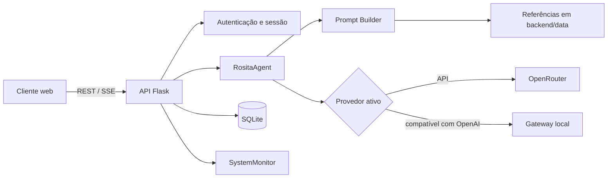

# Arquitetura do Backend

## Visão geral

O backend é uma aplicação Flask empacotada como aplicação WSGI. Em execução local,
o arquivo `backend/app.py` inicia o servidor de desenvolvimento; no Docker, o
mesmo objeto `app` é servido pelo Gunicorn.

## Camadas

- `backend/app.py`: ponto de entrada Flask usado localmente e no contêiner.
- `backend/src/rosita/app_factory.py`: cria a aplicação, configura a sessão,
  o CORS, o limitador e o armazenamento de histórico.
- `backend/src/rosita/settings.py`: consolida configuração por ambiente.
- `backend/src/rosita/bootstrap.py`: monta contexto e instâncias da aplicação.
- `backend/src/rosita/api/routes.py`: endpoints REST, autenticação, chat SSE,
  privacidade, modelos, credenciais e arquivos de referência.
- `backend/src/rosita/core/`: agente, clientes de IA e construção de prompts.
- `backend/src/rosita/utils/`: histórico SQLite, validação, arquivos, ambiente
  e monitoramento do sistema.

## Fluxo de uma conversa

1. O frontend envia `POST /api/chat` com a mensagem.
2. A API valida o tamanho e os caracteres da entrada.
3. O `RositaAgent` monta o contexto a partir das instruções e das referências.
4. O cliente do provedor ativo cria uma conexão com streaming.
5. Os fragmentos são enviados ao navegador em `text/event-stream`.
6. Conforme o consentimento e o modo de histórico, a conversa é persistida no SQLite.

## Provedores de IA

O agente seleciona um cliente por `ROSITA_AI_PROVIDER` ou pela escolha administrativa.

| Provedor | Implementação | Configuração |
|---|---|---|
| OpenRouter | Cliente HTTP compatível com API de chat | `ROSITA_OPENROUTER_API_KEY`, `ROSITA_OPENROUTER_MODEL` |
| Gateway | Cliente OpenAI-compatible | `ROSITA_GATEWAY_URL`, `ROSITA_GATEWAY_MODEL`, `ROSITA_GATEWAY_API_KEY` |

O Gateway deve oferecer `GET /v1/models` e `POST /v1/chat/completions`.

## Dados e persistência

- `backend/data/agent_instructions.txt`: instruções operacionais do agente.
- `backend/data/regimento_ECIM.txt`: referência textual usada pelo contexto.
- `backend/data/regimento_ECIM.pdf`: documento visual servido pela API.
- SQLite: histórico por usuário/sessão, consentimento e exportação/exclusão.

O volume Docker `rosita_history` persiste o banco. Os arquivos editáveis em
`backend/data` podem ser alterados pela interface, mas não são garantidos como
persistentes em uma implantação baseada apenas na imagem do contêiner.

## Segurança

- Senhas verificadas com hashes gerados pelo Werkzeug; os hashes `scrypt`
  exigem aspas simples em arquivos `.env` consumidos pelo Docker Compose.
- Usuário anônimo é identificado por sessão; apenas o perfil administrativo
  acessa login e área administrativa.
- Cookies, HTTPS e consentimento podem ser exigidos por configuração.
- A API aplica limite global e limites específicos para login e chat.
- Chaves e credenciais não são devolvidas ao navegador.
