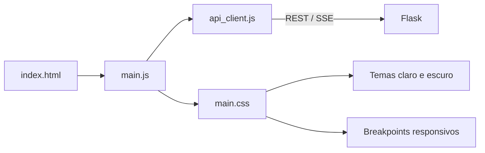

# Arquitetura do Frontend

## Visão geral

O frontend é uma aplicação web sem framework ou etapa de compilação. Os arquivos
HTML, CSS e JavaScript são distribuídos pelo Nginx em produção ou pelo servidor
de desenvolvimento local.

## Organização

- `web/index.html`: estrutura semântica, login, chat, painel administrativo e status.
- `web/styles/main.css`: temas, componentes, responsividade e estados visuais.
- `web/scripts/main.js`: navegação, autenticação, chat, privacidade e administração.
- `web/scripts/api_client.js`: chamadas REST e consumo de SSE.
- `web/scripts/config.js`: configuração da URL da API para desenvolvimento.
- `web/scripts/dev_server.py`: servidor local com proxy `/api`.
- `web/nginx.conf`: arquivos estáticos e proxy para o backend no contêiner.

## Experiência de uso

O visitante pode abrir o chat diretamente e enviar mensagens sem criar conta.
O administrador pode autenticar-se para selecionar provedores e modelos,
editar referências `.txt`, consultar status e configurar credenciais.

A interface oferece tema claro/escuro, histórico da sessão, visualização do
Regimento em PDF, streaming das respostas e controles de privacidade.
Em telas estreitas, a navegação lateral é substituída por uma barra superior.

## Comunicação

As chamadas HTTP usam JSON e o fluxo de chat usa Server-Sent Events.
O servidor de desenvolvimento encaminha `/api/*` ao backend configurado por
`ROSITA_BACKEND_URL`. Em produção, o Nginx encaminha `/api/*` ao serviço Flask.

## Decisões técnicas

Vanilla JS foi mantido para reduzir complexidade de instalação, evitar
dependências de build e facilitar a revisão acadêmica do código. Para evoluções
futuras, podem ser avaliados módulos separados, ferramentas de empacotamento,
testes unitários/E2E e geração de configuração em runtime.
